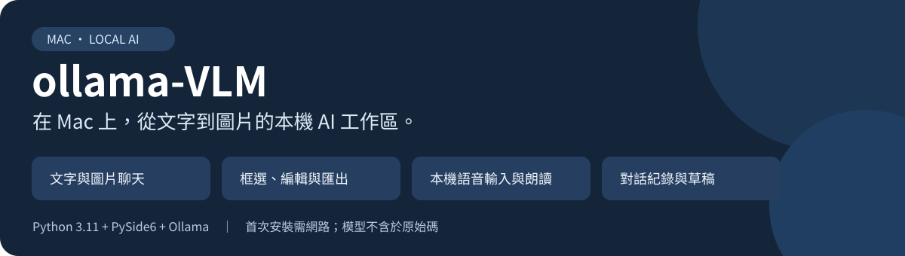
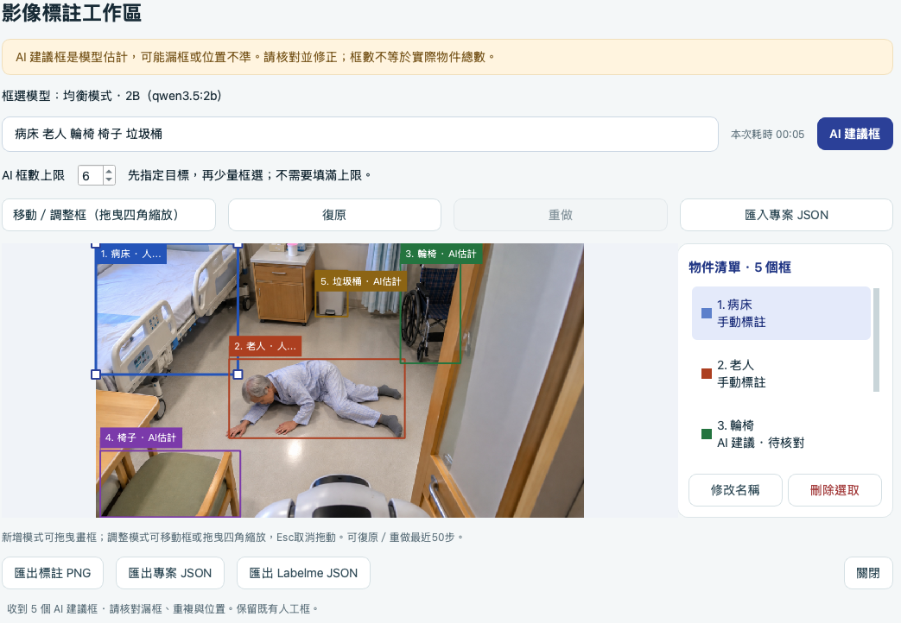

# ollama-VLM · 本機圖文 AI 展示工具

在 Mac 上透過 Ollama 進行文字與圖片聊天，搭配本機語音、圖片標註和對話紀錄。介面採繁體中文，適合教學、展示與本機模型比較。

最新復刻流程已完成乾淨環境驗證；[完整基準與測試限制](REBUILD_VALIDATION_20261019.md)。

**要在新 Mac 完整復刻？** 請讀 [完整重建指南](docs/REBUILD_MAC.md)。系統工具依 `Brewfile` 準備後，雙擊 **`restore.command`** 選基本圖文或完整方案，建立 venv、校驗套件、下載模型並驗收。

| 檔案 | 何時使用 |
| --- | --- |
| `restore.command` | 新電腦重建環境及模型，提供基本／完整方案 |
| `install.command` | 僅建立或檢查 Python 套件環境，不下載模型 |
| `run.command` | 安裝完成後的日常啟動 |

**第一次使用？** 請從 [Mac 安裝圖解](docs/INSTALL_MAC.md) 開始。已安裝者直接雙擊專案中的 **`run.command`**。

希望讓 Codex 協助檢查、安裝與測試？請讀 [使用 Codex 協助安裝](docs/INSTALL_WITH_CODEX.md)，內含可直接貼上的基本／完整方案要求與驗收標準。

> 本儲存庫提供原始碼，不是獨立 App 或完整離線安裝包。Python、Qt、Ollama 與模型需在使用者電腦安裝；首次下載需要網路。私人儲存庫只限已取得存取權限的帳號下載。

## 你可以做什麼

| 功能 | 使用方式 |
| --- | --- |
| 文字與圖片聊天 | 使用圖文模型分析單張 PNG／JPEG／WebP，支援串流與停止生成 |
| 多模型切換 | 9 個預設選項；純文字模型以橘色標示並停用附圖 |
| 圖片標註與匯出 | 人工畫框、移動／縮放、復原／重做，可勾選框中心與四邊中點；匯出 PNG、JSON、Labelme |
| AI 建議框 | 逐框顯示生成預覽；框數上限預設 10，可調整 1–20，結果需人工核對 |
| 本機語音 | Mac 使用 Whisper 將錄音轉文字，再確認傳送；使用系統 TTS 朗讀 |
| 對話與草稿 | 本機保存、搜尋、匯入／匯出文字，另可選擇保存圖片與標註 |


*實際程式截圖，以暫存資料製作，不含私人對話。畫面示範機已安裝模型；新電腦仍須自行下載。*

## Mac 安裝：五個步驟


### 1. 準備工具

適用 **macOS 14 或更新版本**；目前以 **Apple Silicon Mac mini M4、16GB** 驗證。建議 16GB 記憶體；8GB 請從小模型起步並觀察記憶體壓力。Intel Mac／Windows 不具有相同實機驗證範圍。

若您已安裝且正在使用受支援的 [Homebrew](https://brew.sh/)，可安裝：

```sh
brew install python@3.11 ollama
```

Homebrew 對 macOS 的支援範圍與本程式不同；**macOS 14 或不使用 Homebrew者**，請依 [詳細安裝指南](docs/INSTALL_MAC.md#1-準備-python-與-ollama) 使用 Python 官方安裝程式及 Ollama App。已存在的相容環境不必重複安裝。

### 2. 取得專案

在要保存專案的資料夾開啟終端機，逐行執行；每一步成功後才進行下一步：

```sh
git clone https://github.com/orinaisl33-max/ollama-VLM.git
cd ollama-VLM
```

也可從 GitHub 的 **Code → Download ZIP** 下載後解壓，將終端機切換至解壓後的資料夾。Private 儲存庫須先登入有權限的帳號；詳見 [下載方式](docs/INSTALL_MAC.md#2-下載並進入專案)。

### 3. 建立 Python 環境

先安裝 Python 3.11 與 Ollama。再在包含 `main.py`、`run.command` 的專案資料夾雙擊 **`install.command`**，或執行：

```sh
chmod u+x install.command
./install.command
```

安裝器會建立或檢查 `.venv`、安裝官方 PyPI 鎖定套件並強制 SHA256／wheel 校驗、執行 `pip check` 與 Qt 匯入檢查，不會自動刪除既有環境。成功時應看到 `No broken requirements found.` 與「安裝完成」。如果安裝失敗，保留錯誤訊息，先不要跳過鎖版或混用其他 Python 環境。

### 4. 開啟程式

```sh
chmod u+x run.command
./run.command
```

**分步安裝用 `install.command`，整合復刻用 `restore.command`；完成後都用 `run.command` 開啟。**

以後在 Finder **雙擊 `run.command`** 即可。保留整個專案資料夾，不要把啟動檔單獨移走。啟動器會在需要時啟動本機 Ollama，並建立語音權限所需的本機執行環境。

若出現 Apple 無法驗證檔案的提示，確認下載來源後，依 [常見問題](docs/INSTALL_MAC.md#macos-阻擋-runcommand) 處理。

### 5. 下載第一個模型

新電腦的模型選單可能顯示「未下載」。在程式開啟後選：

**設定 → 模型下載與說明 → 均衡模式 · 2B → 下載所選模型**

或在服務已啟動時，另開終端機下載：

```sh
ollama pull qwen3.5:2b
```

完成後回到程式，按 **設定 → 檢查本機服務**。輸入「請用一句話介紹本機 AI」並傳送，確認收到回答。先裝一個模型即可，**不需一次下載全部九款**。

## 第一次看圖

專案附有 [測試圖資料夾](測試圖/README.md)：6 張 JPG，約 3.3MB，包含病房、器械與水果場景。clone 或下載整個 ZIP 即可取得；這些展示素材沒有真值標註，不代表模型準確率驗證。

1. 選擇支援圖片的模型，例如 **均衡模式 · 2B** 或 **Qwen3-VL · 2B · 圖文**。
2. 按 **附加圖片** 選取一張圖，再輸入想詢問的內容。
3. 按 Enter 傳送；Shift + Enter 換行。追問同一張圖時，需重新附圖。

附圖送出後，訊息標頭會顯示「已附加圖片（檔名）」，只顯示檔名。檔名目前保留於本次開啟的視窗；重新載入歷史對話時仍顯示一般圖片提示，舊紀錄不會補上推測的檔名。


*示範對話使用合成雙色圖片的測試問答；此截圖從暫存紀錄載入，沒有保存或顯示私人圖片。*

## 模型怎麼選


| 模型指令名稱 | 下載約量 | 能力與用途 |
| --- | ---: | --- |
| `qwen3.5:2b` | 2.68GB | 文字＋圖片，預設起點 |
| `qwen3.5:4b` | 3.32GB | 文字＋圖片，記憶體需求較高 |
| `qwen3.5:0.8b` | 1.32GB | 輕量圖文，辨識品質較有限 |
| `ministral-3:3b` | 2.95GB | Mistral 圖文模型 |
| `gemma3:4b` | 3.35GB | Google 圖文模型 |
| `deepseek-r1:1.5b` | 1.12GB | 純文字蒸餾推理模型 |
| `qwen3-vl:2b-instruct` | 1.93GB | 圖文；本機合成圖定位測試較佳 |
| `nemotron-3-nano:4b-q4_K_M` | 2.84GB | NVIDIA 純文字模型 |
| `hf.co/LiquidAI/LFM2.5-VL-450M-GGUF:Q4_K_M` | 0.33GB | 超輕量圖文試驗；AI 建議框停用 |

大小取自本機 2026-10-19 安裝紀錄，標籤更新後可能變動；**下載大小不等於執行記憶體用量**。LiquidAI、0.8B 及其他小模型仍可能誤判；AI 框不是可靠偵測器。模型名稱中的 B／M 是參數量單位，VL 表示視覺語言，Instruct 表示指令微調版本。

## 圖片框選與語音


*教學用合成圖片及人工標註，並非 AI 辨識成果。*



*使用者提供並授權公開的操作截圖。目標為「病床 老人 輪椅 椅子 垃圾桶」，本次上限設為 6，畫面共有 5 框；病床與人物已人工調整，其餘仍標示 AI 建議、待核對。這是 AI 輔助加人工修正的範例，不是全自動辨識或跌倒偵測準確率證明。預設上限仍為 10。*

- **框選：** 在附圖或已保存圖片旁開啟「框選／匯出」，可人工畫框；支援的模型亦可產生 AI 建議框。細節見 [LABELME.md](LABELME.md)。
- **朗讀：** 在語音設定選擇關閉、分段朗讀或完成後朗讀，使用 Mac 已安裝的聲音。
- **語音輸入：** 額外安裝 Whisper 引擎與已校驗模型、接上麥克風，再依 [語音輸入指南](VOICE_INPUT.md) 操作。Whisper 非文字聊天的必裝項目。

## 資料與隱私

聊天連線固定為本機 `127.0.0.1:11434`，不呼叫雲端推論。模型和套件下載會連線至供應來源；Ollama 自身設定與日誌另由 Ollama 管理。啟動器只在自己啟動新服務時套用本機與停用雲端設定，會沿用已存在的服務。

對話與草稿預設可保存於使用者的本機應用程式資料夾，並可從介面關閉保存。語音需主動開始錄音，結果先填入輸入框，不自動傳送。影片、圖片生成與音訊檔直接輸入聊天模型尚未支援。

原始碼不包含模型、`.venv`、`.runtime`、私人對話、錄音或執行日誌。[上傳排除與發布說明](docs/PUBLISHING.md) 列出規則及核對方式。

## 更多說明

| 我想做的事 | 文件 |
| --- | --- |
| 新機完整重建 | [完整復刻指南](docs/REBUILD_MAC.md) |
| 用 Codex 協助安裝與測試 | [Codex 安裝教學](docs/INSTALL_WITH_CODEX.md) |
| 下載示範圖片與選擇測試目標 | [測試圖說明](測試圖/README.md) |
| 框太多、太慢或想調整提示詞 | [框選優化與修正指南](docs/ANNOTATION_TUNING.md) |
| 從零安裝、處理錯誤 | [Mac 安裝圖解](docs/INSTALL_MAC.md) |
| 了解哪些檔案不能上傳 | [發布與排除清單](docs/PUBLISHING.md) |
| 安裝本機語音輸入 | [VOICE_INPUT.md](VOICE_INPUT.md) |
| 查看程式結構與開發紀錄 | [開發說明](docs/DEVELOPER_NOTES.md)、[PROJECT_MAP.md](PROJECT_MAP.md) |
| 查看新增模型的實測限制 | [MODEL_EXPANSION_20261019.md](MODEL_EXPANSION_20261019.md) |
| 參考 Windows 安裝 | [WINDOWS_SETUP.md](WINDOWS_SETUP.md)（不是本次 Mac 驗證範圍） |

開發檢查使用 Python 3.11、`requirements-dev.txt` 與 `unittest`；本機最近一次程式回歸為 **257 項通過**，不代表新機已完成驗收。舊 ZIP、HANDOFF_MANIFEST 與帶日期文件屬歷史交接紀錄，**GitHub 安裝不以舊 manifest 校驗作為前置步驟**。


### 遇到問題先檢查

在專案根目錄執行 `./run.command --check`，或使用：

```sh
.venv/bin/python scripts/check_install.py --require-model
```

`PASS` 代表該檢查通過；`WARN` 如選用的 Whisper 缺少，不一定影響文字聊天；`FAIL` 需先處理。模型尚未下載時先開啟程式下載；下載後再執行 `--require-model` 驗收。工具不會錄音、下載模型或讀取對話。只驗證套件時可使用 `--offline`。
