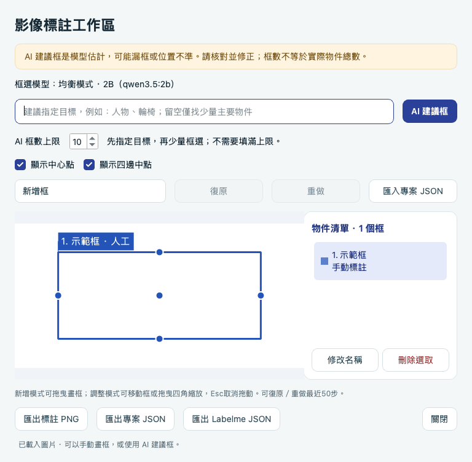

# 框選結果太多、太慢或不準時怎麼調整

[回首頁](../README.md) · [匯出與編輯操作](../LABELME.md)

截圖使用合成色塊與人工標註，只示範操作位置，沒有使用使用者的測試圖片或代表 AI 準確度。

## 場景範例：AI 建議後再人工修正

此操作截圖由使用者提供並授權公開，與上方色塊示範一併保留。它示範的操作是：

1. 目標填「病床 老人 輪椅 椅子 垃圾桶」，框數上限手動設為 6（程式預設仍為 10）。
2. 取得 AI 建議後，切換「移動／調整框」，核對並修正框的位置。
3. 圖中病床、人物的清單已標示「手動標註」，其他框仍為「AI 建議 · 待核對」。人工調整不代表其他框也已確認正確。

畫面總共保留 5 個框，沒有要求填滿上限 6。底部「收到 5 個 AI 建議框」是先前生成完成的訊息，並非目前仍有 5 個未修改的 AI 框；目前來源請以清單為準。此圖不能當成全自動偵測、物件總數或跌倒事件判斷的驗證。

## 建議先這樣使用

1. 附加圖片，開啟「框選／匯出」。不必先請聊天模型列出物件。
2. 看上方「框選模型」，確認是支援圖文的模型。想換模型，先關閉工作區，回主畫面切換，再重新開啟。
3. 在目標欄填一種明確物件，例如「人物」或「輪椅」。只找人物時，不必要求模型推斷年齡；若輸入「老人」漏找，可改成「人物」。
4. 將「AI 框數上限」設成 1–3 後按「AI 建議框」。上限不是要求數量；最多 3 不代表一定有 3 人。
5. 核對漏框與位置，用右側清單刪除錯框、修改名稱；在「移動／調整框」模式拖曳或縮放。漏掉的物件用「新增框」補上。
6. 完成後匯出。修改可復原／重做；不要把模型框數直接當成實際物件總數。

## 如何寫目標

| 想做什麼 | 建議目標 | 上限起點 |
| --- | --- | ---: |
| 找畫面中的人 | 人物 | 1–3 |
| 找一種設備 | 輪椅 | 1–3 |
| 找兩類物件 | 人物、輪椅 | 2–4 |
| 大致瀏覽場景 | 留空 | 10（預設） |

目標欄是搜尋條件，不需要貼入聊天模型的一長串描述。留空現在只找少量主要物件，優先人物與大型獨立物件，避免列舉床單、枕頭及細碎局部。最多可調到 20；只有確實需要較多物件時才增加，更多輸出通常需要更長時間。

預設上限為 10，可用「AI 框數上限」直接選擇 1–20。生成期間，每完成一筆有效座標就先顯示一框，清單與標籤會標示「預覽」；完整結果通過檢查才正式套用。此時原標註仍保留在記憶體，預覽不保存也不可匯出。停止、失敗或格式不完整會撤回預覽；完成後可用復原回到上次標註。逐框顯示改善等待時的可見進度，不會保證模型計算更快。

## 常見情況

| 情況 | 處理方式 |
| --- | --- |
| 一直出現床單、枕頭等細碎框 | 指定真正需要的物件，降低上限，再重新框選 |
| 找不到人 | 目標先用「人物」，不要要求推斷年齡、病況或事件；仍漏找就手動補框 |
| 等待很久 | 指定單一類別、降低上限；可按「停止定位」，原標註會保留。首次載入、硬體與其他工作也會影響速度 |
| 同一張圖重跑仍不同 | 確認同一圖片、模型、目標與上限。固定參數降低波動，無法保證跨引擎／硬體逐次相同或正確 |
| 多個框指向同一物件 | 同名且高度重疊的 AI 框會去重；不同名稱或不同位置不會自動刪除，以免刪掉真正的不同物件，請人工核對 |
| 框選超過上限、格式錯誤或輸出截斷 | 不套用不完整結果，保留原標註；縮小目標或調整上限後重試 |
| 先聊天後框選不同 | 框選請求本身沒有聊天歷史；只帶本次圖片與定位提示。觀察到差異不代表已證明聊天污染，需固定參數重測 |

成功重跑會取代上一輪 AI 框，保留人工框；人工改名或調整過的框已屬人工框，也會保留。

## 維護者如何修改提示詞並驗證

- 提示詞在 `labchat/grounding.py` 的 `grounding_messages`。`grounding_schema` 與文字提示使用相同框數上限；不要只改其中一處。人工框總上限仍為 60，與每次 AI 的 1–20 上限不同。
- `labchat/annotation.py` 依本次上限設定輸出預算；格式不相容的重試保留相同目標、上限與生成參數。
- `labchat/client.py` 只在框選指定 `deterministic=True` 時使用 temperature 0、seed 42，聊天預設參數不變。[Ollama 參數說明](https://docs.ollama.com/modelfile#valid-parameters-and-values)。
- 比較同圖的「留空」「指定一類」「先聊天再定位」，每種至少重跑兩次，記錄模型、目標、上限、耗時、漏框、錯框與位置；比較冷啟動與暖啟動時要分開記錄。只測 JSON 可解析，不能宣稱定位準確。
- 修改後執行回歸：`QT_QPA_PLATFORM=offscreen .venv/bin/python -m unittest discover -s tests`（先依開發指南安裝開發相依）。真實模型與圖片品質另行人工驗收，不放入一般單元測試。
- 使用者圖片、錄音與測試日誌留在本機，教學只使用合成圖；不要將私人測試資料加入 GitHub。

## 顯示中心與四邊中點

勾選「顯示中心點」會在矩形框的幾何中心畫出實心粗圓點；「顯示四邊中點」則在上、下、左、右邊中點各畫一點。兩項皆勾選時，每個框共五點，可分開開關，預設不勾選。

此圖使用空白合成圖片及人工框，圓點與框同色並加白邊。圓點會隨框移動／縮放更新，AI 生成預覽也會顯示。PNG 匯出保留當下勾選的點；專案 JSON 與 Labelme 仍只保存原矩形，不新增點形狀或改動座標。勾選狀態只作用於目前視窗，不寫入對話資料。

中心位置為 `((左+右)/2, (上+下)/2)`；四邊中點由相同框座標計算。這是矩形框中心，不是人物關節、輪廓重心或模型額外偵測結果；不會增加模型請求。
