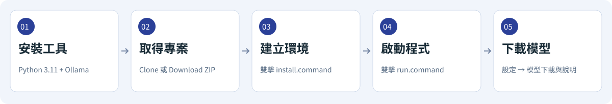
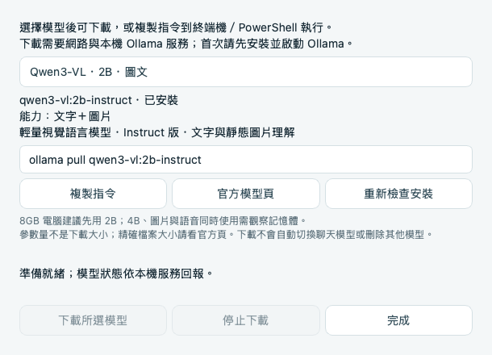
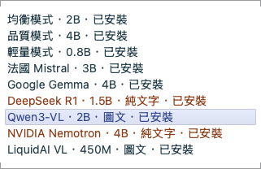
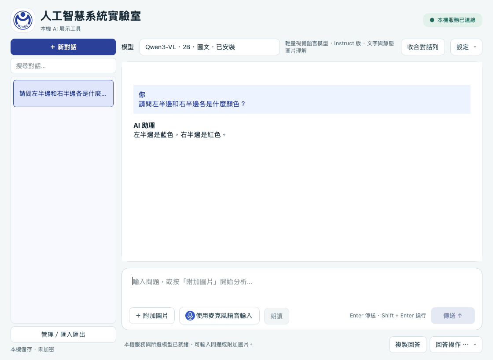
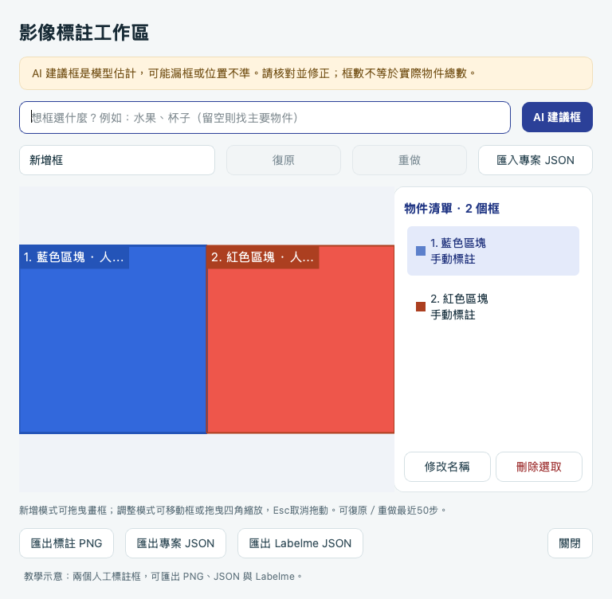

# Mac 安裝圖解

[回專案首頁](../README.md) · [模型選擇](../README.md#模型怎麼選) · [上傳排除清單](PUBLISHING.md)



這份指南為分步安裝。想使用整合精靈重建套件、模型及 Whisper，請先讀 [新 Mac 完整復刻](REBUILD_MAC.md)。

也可依 [使用 Codex 協助安裝](INSTALL_WITH_CODEX.md)，在本機專案貼上安裝要求，讓 Codex 按同一套指南檢查、安裝及驗收。

這份指南供「第一次下載這個專案」的人使用。原始碼不附 Python 環境或模型；請逐步執行，遇到錯誤先處理再繼續。畫面以暫存示範資料製作，不含使用者資料。

## 安裝前確認

| 項目 | 需求／建議 |
| --- | --- |
| 系統 | macOS 14 Sonoma 或更新版本 |
| 晶片 | 建議 Apple Silicon M 系列；Intel 未在本輪實機驗證 |
| 記憶體 | 建議 16GB；8GB 使用較小模型並觀察記憶體壓力 |
| 磁碟 | 建議預留 15GB 以上；下載更多模型須另加空間 |
| 網路 | 首次安裝套件與下載模型需要網路 |
| 本機驗證基線 | Mac mini M4 16GB、Python 3.11、Ollama 0.32.1、鎖定 Qt 套件；新機須重新確認 |

[Ollama 官方 Mac 需求](https://docs.ollama.com/macos) 為 macOS 14 或更新版本，M 系列可使用 CPU／GPU，Intel 為 CPU。Homebrew 的支援範圍可能更嚴格，請依其官網說明選擇安裝方式。

## 1. 準備 Python 與 Ollama

先在終端機查看：

```sh
python3.11 --version
ollama --version
```

若兩者已存在且相容，可以直接進入下一步。不要修改 macOS 系統 Python，也不要從另一台電腦複製 `.venv`。

### 使用 Homebrew

若目前 macOS 符合 [Homebrew 官方支援範圍](https://brew.sh/)，先依官網完成 Homebrew 安裝及它顯示的 PATH 設定，再執行：

```sh
brew install python@3.11 ollama
```

這條路徑安裝的是 Ollama 命令列工具，不會出現 Ollama App 圖示；本專案的啟動檔可以啟動服務，無須另外設定開機常駐服務。

### 使用官方安裝程式

不使用 Homebrew，或 macOS 不符合其支援範圍時：

1. 到 [Python 官方 Mac 下載頁](https://www.python.org/downloads/macos/) 取得與系統相容、具有 macOS 安裝程式的 Python。自動安裝入口固定使用 3.11；其他版本需自行調整並重新驗收，不在此入口支援範圍。
2. 到 [Ollama 官方 Mac 下載頁](https://ollama.com/download/mac) 下載，移入「應用程式」並首次開啟，依提示建立命令列工具。
3. 重新開啟終端機，確認 `python3.11 --version`、`ollama --version` 能執行。

Apple Silicon 請使用原生 arm64 環境，避免混用 Rosetta。可檢查：

```sh
uname -m
python3.11 -c 'import platform; print(platform.machine())'
```

M 系列原生環境預期兩者皆為 `arm64`。

## 2. 下載並進入專案

### 方法 A：Git clone

在您想保存專案的資料夾執行：

```sh
git clone https://github.com/orinaisl33-max/ollama-VLM.git
cd ollama-VLM
```

若儲存庫為 Private，帳號需先取得權限。已安裝 GitHub CLI 者可先 `gh auth login`，再執行 `gh repo clone orinaisl33-max/ollama-VLM`。無權限時不要把 Token 寫入網址或貼進問題回報。

### 方法 B：Download ZIP

在 GitHub 儲存庫頁面選 **Code → Download ZIP**，下載後解壓。Private 儲存庫需先在瀏覽器登入有權限的帳號。

ZIP 解壓資料夾可能叫 `ollama-VLM-main`；請依實際資料夾名稱操作。最簡單的方式是先在終端機輸入 `cd `（含空格），將資料夾拖入，再按 Enter。

執行以下指令，確認位置正確：

```sh
pwd
ls main.py run.command requirements.lock.txt
```

應能找到這三個檔案。若出現 `No such file`，先修正所在資料夾。

## 3. 建立與檢查環境

請先確認 Python 3.11 與 Ollama 可用。在專案根目錄雙擊 **`install.command`**，或執行：

```sh
chmod u+x install.command
./install.command
```

此首次安裝入口會建立或檢查 `.venv`、從官方 PyPI 安裝鎖定 macOS wheel，強制 SHA256 校驗，並執行依賴與 Qt 匯入檢查。不會安裝系統工具、下載聊天模型或變更麥克風權限。

成功時應看到 `No broken requirements found.`、「Qt 匯入正常」與「安裝完成」。如果既有 `.venv` 不完整或來自另一台電腦，安裝器會停止並保留它；請先備份、確認資料位置，再依指示重新建立，不要直接覆蓋。

需要手動建立時，可逐行執行：

```sh
python3.11 -m venv .venv
.venv/bin/python -m pip install --require-hashes --only-binary=:all: -r requirements-macos-hashed.lock.txt
.venv/bin/python -m pip check
```

本次自動安裝入口使用 **Python 3.11**；其他版本不屬此入口支援範圍。若套件失敗，不要默默取消鎖版或用 `sudo pip` 改系統環境。

GitHub 來源包含安裝指南及目前程式，不需要先執行歷史 ZIP 的 `scripts/verify_handoff.py`；舊 `HANDOFF_MANIFEST.json` 對應舊交接包，不是本次 GitHub 來源快照。

## 4. 第一次開啟

```sh
chmod u+x run.command
./run.command
```

以後在 Finder 雙擊 **`run.command`** 即可。啟動時可能開啟終端機，這是啟動腳本的正常行為；不要把它單獨搬出專案。


依畫面位置認識三個入口：

1. **模型：** 左上方下拉選單，選擇本機要用的模型。
2. **設定：** 右上方，包含模型下載、服務檢查與語音設定。
3. **輸入區：** 底部輸入問題；Enter 傳送、Shift + Enter 換行。

啟動器若發現服務未啟動，會以 `127.0.0.1:11434`、停用雲端、單模型／單並行設定啟動 Ollama。若已有服務，啟動器會沿用，不會更改現有服務的設定。

## 5. 下載第一個模型

打開 **設定 → 模型下載與說明**，先選「均衡模式 · 2B」，按「下載所選模型」並確認下載。



*圖為示範機已安裝 Qwen3-VL 的狀態，所以下載按鈕停用；新機選到未下載模型時才可按。畫面中的能力說明會隨模型切換。*

也可以在程式開啟、Ollama 服務已就緒時，另開終端機下載：

```sh
ollama pull qwen3.5:2b
ollama list
```

回到程式按 **設定 → 檢查本機服務**，選單應顯示「已安裝」。先只裝一款即可，不需要一次下載全部。



**橘色＝純文字。** DeepSeek R1 1.5B 與 NVIDIA 4B 不能直接看圖，選到時附圖按鈕會停用。需要圖片請選 Qwen、Mistral、Gemma 或其他標示圖文的選項。LiquidAI 450M 僅作超輕量試驗，未提供 AI 建議框。

若需另一個輕量圖文模型，可下載：

```sh
ollama pull qwen3-vl:2b-instruct
```

請保留 `-instruct` 後綴；實測發現 `qwen3-vl:2b` 別名指向 Thinking 版本，與本工具指定定位 JSON 的流程有差異。

## 6. 驗收文字、圖片與框選

可使用專案附帶的 [6 張測試圖與操作說明](../測試圖/README.md)。圖片已隨專案下載，不需要另外找示範素材；模型答案及座標仍須人工核對。

- **文字：** 輸入「請用一句話介紹本機 AI」，確認畫面出現回答。
- **圖片：** 用圖文模型附加一張不含私人資訊的圖片，詢問顏色或物件位置；自行核對結果。一次一張，支援 PNG／JPEG／WebP。
- **停止：** 請模型產生較長回答，按「停止生成」，確認可修改原問題並再次傳送。
- **紀錄：** 建立新對話，再從「對話紀錄」開啟前一段；預設會保存文字及草稿，圖片保存需另行開啟。



圖片只送入當次請求；要再次分析同一張圖，請重新附圖。小字、數量與複雜物件辨識可能失準，不以回答流暢代表答案正確。

在圖片旁按 **框選／匯出** 可人工標註、編輯及匯出。AI 建議框為估計，必須核對漏框與幾何位置。

開啟後頁面名稱為「影像標註工作區」，目前模型顯示在上方；右側有物件清單、修改名稱與刪除。標籤細線指回所屬框。完整控制與重複框處理見 [框選操作說明](../LABELME.md#在本工具匯出-labelme)；下方圖片是合成圖的人工標註示範，不代表 AI 在真實場景的準確度。

可分別勾選「顯示中心點」「顯示四邊中點」，以粗圓點標示框的五個幾何位置；PNG 匯出保留勾選的點。

「AI 框數上限」預設 10，可調整 1–20。生成過程會逐框顯示預覽；完整驗證後才正式套用。停止或失敗則恢復原標註，預覽期間不能匯出。



*此圖為人工畫框的教學示意，不是 AI 辨識結果。*

## 7. 可選：語音輸入與朗讀

**朗讀** 使用 macOS 已安裝的聲音，在語音設定中選擇模式、音色及語速；不需要下載另一個聊天模型。若缺少中文聲音，請從 macOS 系統設定安裝。

**麥克風輸入** 另外需要 Whisper 引擎、多語言 small 模型及可用的麥克風。完整步驟與 SHA256 校驗碼請依 [VOICE_INPUT.md](../VOICE_INPUT.md) 操作；不要下載 `.en` 英文限定權重。未安裝 Whisper 不影響打字聊天。

第一次錄音時，macOS 可能詢問麥克風權限。錄音最多 30 秒，辨識結果先填入輸入框，確認後才傳送。請使用 `run.command`，讓啟動器建立麥克風用途宣告；真實收音與聽感需由您實測。

## 常見問題

### macOS 阻擋 run.command

`install.command` 與 `run.command` 都可能遇到此提示。若提示「Apple 無法驗證」，先確認檔案來自本專案及您信任的來源。按「完成」，到 ** → 系統設定 → 隱私權與安全性**，找到該檔案的阻擋提示，依系統提供的「強制打開」操作。畫面名稱可能依系統版本不同。

這是單一檔案的允許流程，不需關閉整體安全防護。若顯示已知惡意內容或檔案損毀，不要把它視為同一種警告直接放行。[Apple 官方說明](https://support.apple.com/zh-tw/102445)

### 顯示 Permission denied

先確認位於專案根目錄，再執行 `chmod u+x run.command`，然後重新開啟。

### 顯示 command not found 或找不到虛擬環境

重新開啟終端機，檢查 Python／Ollama 安裝與 PATH；確認專案根目錄有 `.venv/bin/python`；還沒有時，先執行 `install.command`。若既有 `.venv` 不完整或屬於另一台電腦，安裝器會停止。先將它備份移到另一個名稱，再重新安裝；不要把其他資料夾的 Python 環境複製過來。

### 顯示服務未連線

在另一個終端機檢查：

```sh
curl --noproxy '*' -fsS --max-time 5 http://127.0.0.1:11434/api/version
```

若無法連線，確認 `ollama --version` 正常，再正常關閉程式、重新執行 `run.command`。不要為了排除問題而開放外網監聽。若 Ollama 已由其他方式啟動，先確認其設定與日誌。

### 模型未下載或附圖按鈕是灰色

選單不是下載清單的保證。先下載相同標籤的模型，再重新檢查服務；純文字模型本來就不開放附圖。下載中或生成中也可能暫時停用操作。

### 終端機出現 FFmpeg、鍵盤或輸入法訊息

部分訊息為 Qt／macOS 診斷。`Saving session` 是終端機保存工作階段。若視窗自行消失或功能失敗，保留錯誤內容；不要僅憑訊息判定正常。游標警告的追蹤改善見 [診斷紀錄](../CURSOR_DIAGNOSTICS_20261019.md)。

### 安裝包或模型下載失敗

保留實際錯誤、macOS／晶片／Python／Ollama 版本，先檢查網路與可用磁碟。這份指南整理自已驗證的本機環境，不代表每個新機、最新套件或未來模型標籤都已驗證。

## 更新與資料位置

使用 Git clone 者，先正常關閉程式、確認自己的修改已備份，再檢查：

```sh
git status --short
git pull --ff-only
```

若本機有修改或發生衝突，先處理，不要使用強制重設丟棄檔案。若套件鎖版有變，再於原 `.venv` 安裝鎖定套件。下載 ZIP 者請解壓至新資料夾，重新建立環境。

模型預設在 `~/.ollama/models`；Whisper 模型在專案 `models/`；可重建執行環境在 `.venv/`、`.runtime/`；應用程式日誌在 `.logs/`。對話及草稿使用本機使用者應用程式資料位置，原始碼下載不會帶入他人的對話。刪除程式資料夾不等於刪除所有個人資料。

參考官方來源：[Ollama Mac](https://docs.ollama.com/macos)、[Homebrew](https://brew.sh/)、[Python 3.11 formula](https://formulae.brew.sh/formula/python@3.11)、[Ollama formula](https://formulae.brew.sh/formula/ollama)。


## 安裝完成後的檢查工具

```sh
./run.command --check
```

此模式只查詢，不會啟動聊天視窗或自動啟動服務。服務尚未啟動或模型未下載可能顯示 `WARN`。開啟程式並下載模型後，執行較嚴格驗收：

```sh
.venv/bin/python scripts/check_install.py --require-model
```

驗收要求本機服務與至少一個選單模型已就緒。`--offline` 可略過本機 HTTP，僅檢查環境；不與 `--require-model` 同時使用。沒有 Whisper 是選用功能缺少，不代表文字聊天失敗。真實麥克風權限與收音仍需使用者主動實測。

單台實機測試無法提供所有電腦都 100% 成功的保證。本專案有乾淨來源與全新環境重建紀錄，但未驗證每種 macOS／網路／硬體。檢查工具協助定位失敗，不能取代真實模型與硬體操作驗收。
